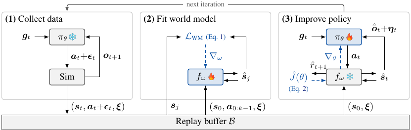
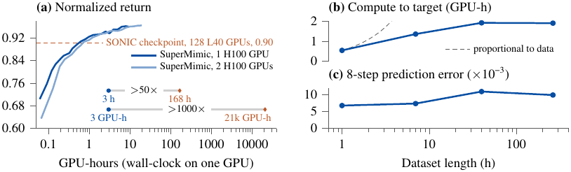
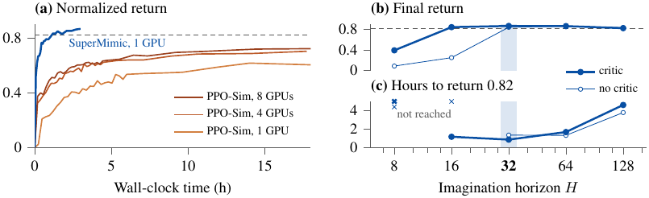
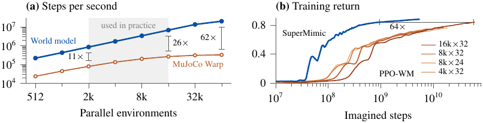
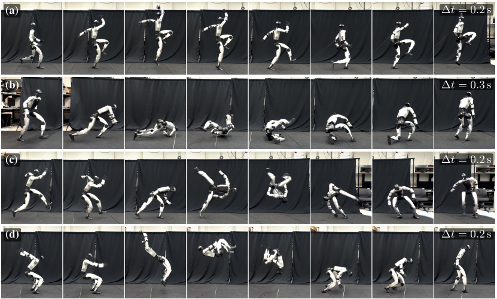

# SuperMimic 学习笔记

SuperMimic 做的是大规模人形机器人动作跟踪：输入参考动作和机器人观测，输出关节控制指令。论文报告，单张 H100 训练 3 小时，跟踪回报就超过了 SONIC 已发布的检查点；后者报告的训练配置是 128 张 L40、7 天。

顺着这个结果往下读，需要回答三个问题：训练贵在哪里？世界模型怎样帮助策略更新？优势在哪些对照实验中成立？下面按这三个问题整理，并把方法部分对到作者代码。

论文设置与当前代码默认值有几处差异，文中分别标明。

## 01 解决什么问题：动作库扩大导致训练成本增加

人形机器人可以跟踪走路、舞蹈、跳跃、侧滚等参考动作，但参考关节轨迹并不能直接当成可靠的控制指令。机器人自身的惯量、驱动能力与接触约束，都会影响实际运动。控制器需要根据当前观测不断修正动作。

现有方法通常使用无模型强化学习。有的先训练多个动作专家，再蒸馏成统一策略；有的在大动作库上直接训练一个通用策略。覆盖更多动作，往往需要更多仿真采样和训练算力。

SuperMimic 利用的是动作之间共享的身体动力学。给定身体状态、实际动作和物理参数后，状态转移遵循同一具机器人的物理规律。参考动作改变的是控制目标，许多动力学规律仍可复用。

原文 §4.2 明确使用了“shared body and contact dynamics”。其含义是学习包含接触效应的动力学，并在不同动作之间摊销学习成本。[P1](#P1)

因此，方法的任务是同时学好两件事：一个能连续推演的动力学模型，以及一个能利用这个模型、跟踪不同目标的控制策略。

## 02 用什么方法：仿真收集数据，模型提供可微轨迹



**图1｜训练循环。** 对应原文图2，p.4，§3.1；三个面板分别是收集数据、拟合世界模型、改进策略。虚线表示梯度。

### 2.1 在仿真器中执行动作，记录状态转移

从机器人当前状态s和参考运动目标g出发。θ表示 Actor 参数，ω表示世界模型参数，ψ表示价值网络参数；ξ记录摩擦、关节标定偏移、躯干质心偏移等仿真上下文。

每个控制步，Actor 首先接收机器人的本体感知。论文附录A列出的单帧观测为：

<a id="E001"></a>

$$
\begin{aligned}
\bar{\boldsymbol o}_t
 &=\operatorname{concat}\left(
 \boldsymbol g^b_t,\boldsymbol\omega^b_t,
 \boldsymbol q_t-\boldsymbol q^0,\dot{\boldsymbol q}_t,
 \boldsymbol a_{t-1}\right),\\
\boldsymbol o_t&=\bar{\boldsymbol o}_t+\boldsymbol\eta_t.
\end{aligned}
$$

**式（1）｜本体感知观测。** 对应原文附录A、表A.1；拼接顺序按当前代码 `compute_wm_obs()`、`compute_actor_sensor()` 整理。[C4](#C4)

上横线表示无噪声观测，η表示传感噪声。这里的 gᵇ 是身体坐标系中的重力方向，与参考目标 g 不同。G1 每帧合计 93 维。论文策略使用最近10帧观测，代码通过历史缓存拼接；而当前运行默认 `actor_obs="rep_state"`、`history_length=1`，需要显式选择 `proprio` 与历史长度，才能对齐论文的观测设置。[C10](#C10)

观测还要与参考目标一起输入策略。为让运动跟踪、速度等目标接口共用控制器，附录B把 Actor 写成目标编码器和共享解码器：

<a id="E002"></a>

$$
\boldsymbol z=\operatorname{enc}_{\theta,i}(\boldsymbol g),\qquad
\boldsymbol a=\operatorname{dec}_\theta(\boldsymbol z,\boldsymbol o).
$$

**式（2）｜原文式（A.1），p.14。** 代码 `MultiEncoderAE.forward()` 将各接口目标编码，经 tanh 得到32维潜在表示，与观测历史一起送入共享解码器。

Actor 产生动作后，收集阶段加入动作噪声，再交给仿真器执行。仿真器返回下一状态，同时把状态、实际执行动作、运动片段位置和上下文存入回放缓冲区。这里必须记录加噪后的动作，后面的动力学拟合才能对上这次真实执行的状态转移。[C1](#C1)

### 2.2 从记录状态出发，连续预测并修正模型

回放缓冲区有了连续的状态—动作记录，就可以训练模型接替仿真器做状态推进。之后策略还要用预测结果评分、判断是否终止，并获得下一次决策的观测。为了让这一步推演具备这些输出，正文 §3.2 将世界模型组织为动力学、奖励、观测和终止四个头：

<a id="E003"></a>

$$
\begin{aligned}
\hat{\boldsymbol s}_{t+1}&=f_\omega(\hat{\boldsymbol s}_t,\boldsymbol a_t,\boldsymbol\xi),\\
\hat r_{t+1}&=r_\omega(\hat{\boldsymbol s}_t,\boldsymbol a_t,\boldsymbol g_t),\\
\hat{\bar{\boldsymbol o}}_t&=g_\omega(\hat{\boldsymbol s}_t,\boldsymbol\xi),\\
\hat d_t&=d_\omega(\hat{\boldsymbol s}_t,\boldsymbol g_t).
\end{aligned}
$$

**式（3）｜世界模型的四类输出，对应原文 §3.2 无编号公式组，p.5。**

帽号表示模型量。动力学头产生下一状态，另外三个头使模型中的轨迹能够被评分并继续交给 Actor。

这四类输出各有计算路径。论文允许学习头与解析头混合使用，当前官方代码对应如下。

**表1｜四类输出与当前官方实现。论文定义见 §3.2；代码见 [C3](#C3)–[C6](#C6)。**

| 输出 | 当前代码怎样得到 | 是否有独立预测损失 |
| --- | --- | --- |
| 动力学 | `Dynamics.forward()` 预测增量，再由状态表示模块积分 | 有，监督状态误差 |
| 奖励 | 从预测状态恢复身体运动量，调用 `tracking_reward()` | 无独立奖励回归项 |
| 无噪声观测 | 从状态构造重力投影、角速度、关节位置/速度及上一动作 | 无独立观测回归项 |
| 终止量 | 按高度与倾斜误差构造平滑阈值函数 | 无独立 BCE 拟合项 |

在 GenCoord 路径中，MLP 输入归一化后的状态、缩放后的动作以及上下文。动作缩放为关节设定点；网络输出根部线速度、角速度和关节速度的增量，再积分得到新状态。

以关节部分为例，代码整理为：

<a id="E004"></a>

$$
\begin{aligned}
\boldsymbol q^{\mathrm{sp}}_t&=\boldsymbol\alpha\boldsymbol a_t+\boldsymbol q^0,\\
\dot{\boldsymbol q}_{t+1}&=\dot{\boldsymbol q}_t+\Delta\dot{\boldsymbol q}_t,\\
\boldsymbol q_{t+1}&=\boldsymbol q_t+
 (\dot{\boldsymbol q}_t+\kappa\Delta\dot{\boldsymbol q}_t)\Delta t,\\
\kappa&=\frac{n+1}{2n}.
\end{aligned}
$$

**式（4）｜动作映射与关节积分。** 第一行对应附录A的动作定义；其余为 `GenCoordRepresentation.apply_prediction()` 与 `create_representation()` 的代码整理。n 是每个控制步的物理子步数。根部位姿另有平移、四元数积分与坐标变换。[C3](#C3)

这让网络集中学习速度变化，位置和姿态按规定的积分结构更新。它给模型施加了运动学结构，也减少了逐项预测身体量时可能出现的不一致。

得到一步预测后，继续把预测状态送回动力学头，沿缓冲区里的记录动作递推。论文在这里展开 **k=8步**，把每一步的预测与对应仿真记录比较。这样，早期误差对后续状态的影响也会进入拟合目标：

<a id="E005"></a>

$$
\begin{aligned}
\mathcal L_{\mathrm{WM}}(\omega)
=\mathbb E_{\mathcal B}\sum_{j=1}^{k}\Big[
&\|\hat{\boldsymbol s}_j-\boldsymbol s_j\|^2
+(\hat r_j-r_j)^2\\
&+\|\hat{\bar{\boldsymbol o}}_j-\bar{\boldsymbol o}_j\|^2
+\operatorname{BCE}(\hat d_j,d_j)\Big].
\end{aligned}
$$

**式（5）｜原文式（1），p.5，§3.2。解析头没有对应拟合损失项。**

这四项分别监督状态、奖励、无噪声观测与终止。每个窗口只有起点使用记录状态，后续由模型自己递推；整个窗口的误差一起反传，更新世界模型参数ω。

当前仓库只优化 `dynamics.parameters()`。另外三个头采用解析路径，`_compute_losses()` 计算的是分组、按标称误差归一化的状态损失。按代码归约方式，可以写成：

<a id="E006"></a>

$$
\mathcal L_{\mathrm{state}}
=\frac{1}{\sum_{b\in\mathcal G}d_b}
\sum_{b\in\mathcal G}d_b\,
\frac{\operatorname{MSE}(\hat{\boldsymbol z}_b,\boldsymbol z_b)}{\epsilon_b^2}.
$$

**式（6）｜当前代码 `_compute_losses()` 的等价整理，[C2](#C2)。** 分组集合为 G，dᵦ 是组内通道数，MSE 对批次、预测步及组内通道取平均，εᵦ 是该组标称误差。它按通道数量汇总各组误差。

GenCoord 当前监督四组：根部位置、根部朝向、关节位置和关节速度。默认标称误差分别为 0.01、0.02、0.1、3.14。根部朝向用旋转矩阵乘以 √0.5 后的通道表示；当前模型里还存在的重力方向、根部速度等量，并没有各自独立的一组损失。[C2](#C2)[C3](#C3)

按这些误差更新动力学参数后，本轮模型拟合完成。当前默认 `wm.horizon=8` 传给缓冲区得到的是 **8帧记录**，`_rollout()` 执行L−1次，实际监督7次转移；这与论文定义的k=8步需要分别核对。[C2](#C2)

### 2.3 用当前策略连续推演32步，累计动作的后果

下一步固定刚更新的世界模型参数，从回放缓冲区取一批起点，转而让当前 Actor 产生动作。动力学按这些动作预测下一状态，再通过可微正向运动学恢复各身体部位的位置、朝向和速度。

此时需要评价这次动作有没有跟上参考，奖励头开始参与计算。当前 `tracking_reward()` 将六个指数型跟踪项与动作平滑、关节限位代价合在一起：

<a id="E007"></a>

$$
\begin{aligned}
r_{t+1}=\Delta t\Bigg[
&\sum_{i=1}^{6}w_i\exp\left(-\frac{E_i}{\sigma_i^2}\right)
-0.1\|\boldsymbol a_t-\boldsymbol a_{t-1}\|^2\\
&-2\sum_j\left(\max(0,q_j-q_j^{\max})
+\max(0,q_j^{\min}-q_j)\right)\Bigg].
\end{aligned}
$$

**式（7）｜原文表A.2的汇总写法，权重与形式也见当前代码 [C5](#C5)。控制周期 Δt=0.02秒，依据原文表A.6图注。**

**表2｜六个跟踪奖励的误差、尺度与权重。对应原文表A.2，p.14。**

| 项目 | 平方误差 E | σ | 权重 w |
| --- | --- | --- | --- |
| 身体位置 | $\frac{1}{\lvert\mathcal T\rvert}\sum_{b\in\mathcal T}\|\boldsymbol p_b^{\mathrm{des}}-\boldsymbol p_b\|^2$ | 0.3 | 1 |
| 身体朝向 | $\frac{1}{\lvert\mathcal T\rvert}\sum_{b\in\mathcal T}\|\log(R_b^{\mathrm{des}}R_b^\top)\|^2$ | 0.4 | 1 |
| 身体线速度 | $\frac{1}{\lvert\mathcal T\rvert}\sum_{b\in\mathcal T}\|\boldsymbol v_b^{\mathrm{des}}-\boldsymbol v_b\|^2$ | 1.0 | 1 |
| 身体角速度 | $\frac{1}{\lvert\mathcal T\rvert}\sum_{b\in\mathcal T}\|\boldsymbol\omega_b^{\mathrm{des}}-\boldsymbol\omega_b\|^2$ | 3.14 | 1 |
| 根部位置 | $\|\boldsymbol p_{\mathrm{root}}^{\mathrm{des}}-\boldsymbol p_{\mathrm{root}}\|^2$ | 0.3 | 0.5 |
| 根部朝向 | $\|\log(R_{\mathrm{root}}^{\mathrm{des}}R_{\mathrm{root}}^\top)\|^2$ | 0.4 | 0.5 |

T 是被跟踪身体部位的集合。位置、朝向与速度都要跟上参考；平滑项限制连续控制指令的跳变，限位项使用环境配置的软关节限位，惩罚超出该范围的部分。误差为零时指数项接近1，误差达到尺度σ时为 exp(−1)，约0.368。

代码中还有两处具体处理。第一，身体位置和朝向目标会重锚定到预测根部的水平位置与偏航；根部自身的跟踪项仍使用原始参考，因此“整体走偏”和“身体内部姿态错了”由不同项处理。第二，朝向误差使用相对旋转的角距离，`acos` 的输入会被夹在奇异端点以内，以避免梯度发散。[C5](#C5)

GenCoord 的身体位置、朝向和速度来自预测关节状态的可微正向运动学；这些量再进入奖励函数。奖励由状态计算得到，梯度也就可以沿奖励、运动学和动力学一路回传。[C3](#C3)

**评分时刻也要核对。** 论文紧凑地写 rω(sₜ,aₜ,gₜ)。当前 `_wm_step()` 先预测下一状态，再用推进前缓存的参考帧评价奖励与终止，随后才更新参考指令。于是代码中的一步奖励已经包含“当前动作→下一状态→评分”的依赖，求导时这一段也要保留。[C6](#C6)

这一步还要判断机器人是否接近失败，否则跌倒后的预测也可能继续获得跟踪分数。终止头据此计算后续轨迹的生存权重。原文附录A规定，根部高度偏离参考超过0.25米，或重力方向的竖直分量差超过0.8时终止。当前代码读取环境阈值，把较大的归一化误差送入 sigmoid：

<a id="E008"></a>

$$
\begin{aligned}
e_t&=\max\left(
 \frac{|e_{p,z,t}|}{h_{\mathrm{th}}},
 \frac{e_{\mathrm{tilt},t}}{\tau_{\mathrm{th}}}\right),\\
\hat d_t&=\operatorname{sigmoid}\left(\frac{e_t-1}{\beta}\right),\\
\hat c_0&=1,\qquad
\hat c_{t+1}=\hat c_t(1-\hat d_{t+1}).
\end{aligned}
$$

**式（8）｜前两行由代码 `_compute_term_prob()` 整理，默认β=0.05；末行是原文 §3.1 的生存权重递推。** 高度、倾斜阈值来自环境配置，复现时应以运行配置为准。[C6](#C6)[C10](#C10)

误差恰好达到阈值时，终止量为0.5；远低于阈值接近0，远高于阈值接近1。阈值附近保留了状态导数，策略可以获得接近终止边界的更新信号。

这个终止量由规则平滑得到，没有拟合终止标签的 BCE，也不能把它当成经过数据校准的不确定性估计。论文容许学习头或解析头，这里采用的是解析实现。

完成评分后，把预测状态转换成式（1）的观测，更新上一动作、观测历史与相对目标，再让 Actor 输出下一动作。奖励与终止量按同样方式逐步累计。论文默认连续展开 **H=32步**，控制周期0.02秒，对应0.64秒模型轨迹。

32步之外的收益由末端价值V补上，整条轨迹于是得到下面的优化目标：

<a id="E009"></a>

$$
\hat J(\theta)=\mathbb E\left[
\sum_{t=0}^{H-1}\gamma^t\hat c_t\hat r_{t+1}
+\gamma^H\hat c_H
 V_\psi(\hat{\boldsymbol s}_H,\boldsymbol g_H,\boldsymbol\xi)
\right].
$$

**式（9）｜原文式（2），p.5，§3.3。默认H=32、γ=0.99。**

r 是一步奖励；J 是把多步结果合在一起的目标；V 估计末端状态之后还能获得的回报。三者对应不同对象。

V 由输出标量的 MLP 计算，默认隐藏层宽度为256、128。输入由模型状态表示、目标与仿真上下文拼接得到，比 Actor 的本体感知更充分。它的数值通过式（13）的监督目标学习，无法仅从当前一步奖励直接读出。对应代码是 `_critic_obs()` 与 Runner 中的 `build_mlp()`。[C13](#C13)

前半部分由世界模型展开计算，后半部分由 Critic 自举。c 控制终止之后的贡献。按原式，当前转移奖励乘 cₜ，随后再更新 cₜ₊₁；当前代码也按这个顺序执行。

`BpttPolicyLearner._train_batch()` 保留了奖励累加的计算图，`ActorCriticPolicyLearner._bootstrap()` 再接入末端价值。Critic 参数在 Actor 更新时被冻结，但其输出对末端状态的导数仍保留。[C7](#C7)


### 2.4 沿刚展开的轨迹反传，更新 Actor

这32步已经连接成一张计算图：某一步动作会改变后续状态，状态又会改变观测、下一步动作、奖励与生存权重。为了改进 Actor，代码对刚刚累加的回报做时间反向传播（BPTT），把这些影响一直传回策略参数θ。

要写清完整依赖，可以把身体状态、辅助位姿、上一动作和观测历史统一记为 x；固定的参考运动序列与采样噪声作为外部输入。令 Π 表示包含观测、目标构建与 Actor 的组合映射，F 表示一步状态与历史更新，R 表示该步评分：

<a id="E010"></a>

$$
\begin{aligned}
\boldsymbol a_t&=\Pi_\theta(\boldsymbol x_t),\\
\boldsymbol x_{t+1}&=F_\omega(\boldsymbol x_t,\boldsymbol a_t),\\
\hat r_{t+1}&=R_t(\boldsymbol x_t,\boldsymbol a_t),\\
\hat d_{t+1}&=D_t(\boldsymbol x_{t+1}).
\end{aligned}
$$

**式（10）｜本文对代码计算图的统一记号，原文未单独列出此式。** R 包含预测下一状态后再评分的组合；Π 包含随状态变化的观测和相对目标，因此这些路径也会被自动求导。

用总导数 Xₜ、Aₜ、Cₜ 分别记录状态、动作、生存权重对θ的变化，链式法则给出：

<a id="E011"></a>

$$
\begin{aligned}
X_t&=\frac{\mathrm d\boldsymbol x_t}{\mathrm d\theta},
\qquad A_t=\frac{\mathrm d\boldsymbol a_t}{\mathrm d\theta},
\qquad C_t=\frac{\mathrm d\hat c_t}{\mathrm d\theta},\\
A_t&=\Pi_xX_t+\Pi_\theta,\\
X_{t+1}&=F_xX_t+F_aA_t,\\
C_{t+1}&=(1-\hat d_{t+1})C_t
-\hat c_t\,D_xX_{t+1},\\
X_0&=0,\qquad C_0=0.
\end{aligned}
$$

**式（11）｜对式（10）及生存权重的链式展开。** 下标x、a、θ表示局部偏导；Dₓ在下一状态处取值。起点来自缓冲区，本次更新中视作固定量。X 是“整条历史造成的总变化”，Πθ这一项是 Actor 在输入固定时对自身参数的局部偏导。

由此，单条轨迹目标 L 的完整梯度为：

<a id="E012"></a>

$$
\begin{aligned}
\frac{\mathrm d\hat L}{\mathrm d\theta}
={}&\sum_{t=0}^{H-1}\gamma^t
 \left[\hat c_t(R_xX_t+R_aA_t)
 +\hat r_{t+1}C_t\right]\\
&+\gamma^H\left[\hat c_HV_xX_H+V_HC_H\right].
\end{aligned}
$$

**式（12）｜式（9）期望内部目标的完整求导，依据原文 §3.3 与代码 [C7](#C7)[C8](#C8)。** 这里V是末端 Critic 关于x的组合函数；对当前代码求导时，还包含其上界裁剪操作。

第一行包括奖励改变与存续权重改变的影响，第二行包括末端价值及到达末端权重的影响。式（11）继续展开后，会覆盖早期动作改变后续状态、观测和后续动作的所有依赖。

实际代码用反向模式自动微分计算这些量，无需显式保存庞大的X矩阵。`update()` 对动力学和表示模块设 `requires_grad_(False)`，只冻结参数；Actor 的动作仍然进入可微计算。`loss` 再交给 `_optimize_step()` 调用反向传播。[C7](#C7)[C9](#C9)

`_train_batch()` 接入末端价值后，有下面两行：

```python
ret = ret + self._bootstrap(obs, survival, term_prob)
loss = (-ret + aux_loss).mean()
```

**代码片段1｜官方 `policy_learner.py` 第116–117行，[C7](#C7)。** `aux_loss` 来自多接口潜在对齐；当前默认只启用motion接口时这一项为0。启用其他接口后，代码对非锚点编码器增加潜在均方对齐损失，并停止锚点目标的梯度。式（12）展开的是回报部分，辅助项另行求导。[C12](#C12)

一个容易误读的 `detach()` 在 Critic 数据存储处：记录到 `rollout` 的状态、奖励与终止量会分离，但用来累计 Actor 回报的 `reward` 与 `survival` 仍在计算图里。将这里整个推演包进 `no_grad()`，会切断论文所需的策略更新路径。

### 2.5 用同一批轨迹更新 Critic，再回到仿真器

Actor 更新时使用的是已有 Critic 对末端的估计。接下来还要更新 Critic 自身，使下一轮自举有更合适的价值估计。

对应的监督目标使用同一批想象轨迹。论文将 Critic 损失与回报目标写为：

<a id="E013"></a>

$$
\begin{aligned}
\mathcal L_V(\psi)
 &=\mathbb E\sum_{t=0}^{H-1}(V_t-\hat R_t)^2,\\
\hat R_t
 &=\hat r_{t+1}+\gamma(1-\hat d_{t+1})
 \left[(1-\lambda)V_{t+1}+\lambda\hat R_{t+1}\right],\\
\hat R_H&=V_H.
\end{aligned}
$$

**式（13）｜前两行对应原文式（3），末行是紧接原式给出的递推边界。默认λ=0.95。**

代码的 `gae_returns()` 用优势残差形式实现同一个递推：先算一步 TD 残差，再逆序累计优势，最后加回 V 得到回报目标。`_fit_critic()` 在 `no_grad()` 下计算价值与目标，随后最小化目标和当前 Critic 输出的均方误差，目标在这一轮拟合中固定。[C8](#C8)

当前代码还把末端价值和 Critic 目标裁到回报上界，上界按运行环境的正奖励权重和控制周期读取。若使用表A.2的六项正权重与0.02秒周期，每步最大正奖励为0.1，γ=0.99时得到0.1/(1−0.99)=10。它是价值裁剪上界，与实验中的归一化跟踪回报不同。[C7](#C7)[C8](#C8)

Actor 与 Critic 更新结束后，改进后的 Actor 回到仿真器继续执行动作，新状态和新动作重新进入回放缓冲区。下一轮再用这些数据修正世界模型。这样，策略访问到的状态会不断改变模型的训练数据，更新后的模型也会继续影响策略的梯度。

官方代码的 `SuperMimicRunner.run()` 依次调用 `world_model_learner.update(data)` 和 `policy_learner.update()`，仿真收集由 `step()` 完成；`_train_batch()` 先优化 Actor，再拟合 Critic，对应上述顺序。[C1](#C1)[C7](#C7)[C8](#C8)

## 03 达到什么效果：比较对象、指标和预算放在一起看

论文的归一化回报，是完整仿真回合的未折扣奖励总和除以其最大可能值。当前日志里的 `Policy/reward` 则由想象回报除以H与控制周期得到，包含折扣和末端自举。[C7](#C7)

### 3.1 相对 SONIC 与 PPO-Sim 的结果



**图2｜总体比较与数据规模扫描。** 对应原文图3，p.7；(a)是与 SONIC 的比较，(b)(c)为数据规模与模型误差。

**表3｜整体系统比较。对应原文 §4.1、图3(a)、附录F表A.8。**

| 方法与训练点 | 计算配置 | 129514个动作中的失败数 |
| --- | --- | --- |
| SONIC 已发布检查点 | 报告为128张L40、7天 | 179 |
| SuperMimic | 1张H100、3小时 | 25 |
| SuperMimic | 2张H100、9.8小时 | 0 |

单H100训练3小时内，SuperMimic 的归一化回报超过 SONIC 检查点。作者概括实际耗时降低超过50倍，GPU小时降低超过1000倍。

配置差异也要随表一起读：SONIC 用611小时运动数据，SuperMimic 用其公开子集264.56小时；GPU型号不同。基准动作属于双方训练集，失败数衡量训练库覆盖。评估统一了物理设置和失败规则，但各策略保留自身执行器增益与观测构建。[P2](#P2)



**图3｜更接近算法差异的比较，以及价值网络消融。** 对应原文图4，p.7。

**表4｜PPO-Sim 对照。对应原文 §4.1、图4(a)，LAFAN1共40个片段、2.45小时。**

| 方法 | GPU数 | 报告结果 |
| --- | --- | --- |
| SuperMimic | 1 | 约1.2小时达到0.82评估回报 |
| PPO-Sim | 1 | 18小时预算内未达0.82，最终约0.60 |
| PPO-Sim | 4 | 同预算内未达0.82，最终约0.70 |
| PPO-Sim | 8 | 同预算内未达0.82，最终约0.72 |

这组对照共享动作、观测、奖励、终止、域随机化、网络规模与评估协议。PPO-Sim 每GPU使用8192环境，SuperMimic为4096。与 SONIC 的整体对照合起来看，证据比单独引用一个“千倍”数字充分。[P2](#P2)

### 3.2 效率来自模型速度，也来自梯度更新



**图4｜轨迹生成与策略更新效率。** 对应原文图5，p.8。

原文图5(a)中，在实际使用的2k–16k并行批量范围，世界模型的控制步吞吐超过 MuJoCo Warp 的10倍。物理仿真每个50 Hz控制步由四个5 ms子步构成，世界模型采用训练中的TF32精度。

原文图5(b)把 PPO 也放在世界模型上训练。在行走、跑步、冲刺子集，SuperMimic 用约少64倍的想象步数达到 PPO-WM 最佳训练回报；PPO-WM 测试的批量中16k×32最好。这里比较学习步数，不能再与吞吐倍数直接相乘为端到端加速。[P3](#P3)

数据规模从1小时增加到264小时时，8步归一化状态预测误差约在0.007–0.011，达标计算成本增长缓慢。这支持作者关于跨动作复用动力学的解释，尚不足以建立无限规模下的误差保证。[P1](#P1)

### 3.3 价值网络、实机和下游任务

**表5｜其余关键证据。对应原文 §4.3–4.5、图4(b,c)、图6、图7及附录G。**

| 实验 | 对照与结果 | 说明 |
| --- | --- | --- |
| 时域与Critic | H=16时无Critic未达目标回报，有Critic可达；H=32达标最快 | 末端价值支持较短想象时域 |
| 仿真抗推 | T字姿态下施加0.5–4 m/s速度扰动；有Critic在0.5–2.4秒稳定，无Critic持续踉跄或跌倒 | 跟踪回报相近时，恢复行为仍可不同 |
| 真实G1 | 同一跟踪器执行跳步、侧滚、90°与原地360°翻转，无逐动作调参 | 展示实机迁移，未报告全动作库的实机成功率 |
| 速度接口 | RL编码器在672个响应中的650个误差更低；误差中位数0.16，蒸馏为0.49 | 每策略一个训练种子，属于初步结果 |



**图5｜真实G1上的动作展示。** 对应原文图6，p.9；依次为跳步、侧滚、90°翻转、原地360°翻转。[P4](#P4)

速度实验比较的是用自身任务奖励训练编码器，与使用参考动作跟踪奖励训练的蒸馏基线；下游奖励只更新对应编码器，解码器仍由运动跟踪目标更新。

当前代码的多接口环境在各个 slot 上统一计算运动跟踪奖励，速度指令从参考运动投影得到；它没有在这一环境路径里切换成论文速度任务的独立奖励。因此，论文中 RL 速度编码器与蒸馏基线的比较，需要按附录G理解，不能把当前默认多接口运行直接等同于该实验。[C11](#C11)

主文称多个种子训练稳定，因此没有报告曲线的种子变化；速度实验明确每种策略只有一个种子。这些结果提供了方法效果的证据，后续复现还需要补上跨种子的波动范围。

## 读后：探究SuperMimic省掉了哪部分学习负担

读完论文再看代码，最明显的感受是任务结构被利用得很充分。状态是低维的机器人运动量，奖励可以由参考动作与可微运动学计算，终止也有明确的几何规则。动力学网络承担难以直接求导的状态转移，其他可计算关系继续保留。这些条件共同降低了模型学习的负担，也让 Actor 得到比较稠密的梯度。

由此再看“世界模型带来效率”，就能具体到哪些计算被共享、哪些目标无需再学。扩展到物体操作时，如果成功判定依赖接触事件，奖励稀疏，物体状态又难以观测，四个头中需要学习的部分可能增加。运动跟踪里的结果，不能直接当成通用任务的样本效率承诺。

把预测精度和控制梯度分开考察。状态预测误差小，说明预测值接近记录；Actor 更新使用的是状态对动作的导数。两个模型即使给出相近预测，也可能在邻域给出不同导数。本文用控制表现证明这套梯度足以训练有效策略，但没有逐类量化接触切换处的梯度误差。

代码也能看出维护梯度的成本：姿态更新采用结构化积分，旋转误差避开 acos 奇异点，终止规则用平滑阈值，Actor 梯度做裁剪，末端价值设上界。它们分别约束了计算图中的不同风险。复现时若只复刻网络层数和H=32，漏掉这些处理，训练行为可能相差很大。

Critic 也改变了误差分配。短模型时域减少推演误差和反向传播成本，末端价值把更远的后果接回来，同时也引入价值估计偏差。H=32 是作者设置中的实验选择。换任务后，应当重新检查：当前模型在哪个时域内可信，末端价值又能否正确评价难恢复的状态。

最后，论文和当前仓库的差异说明，公开代码是一个持续变化的实现。这里的状态表示、标称误差、历史长度、终止平滑和优化器，都影响“同一个方法”最终跑出来的结果。要讨论能否复现3小时成绩，需要固定提交、数据、完整运行配置和评估口径，再看墙钟时间与失败动作数。

---

### 原文与代码定位

**论文**：*SuperMimic: Scaling Humanoid Whole-Body Control with One Differentiable World Model*，Qiayuan Liao 等，UC Berkeley。[arXiv v1](https://arxiv.org/abs/2610.28480v1) · [项目主页](https://supermimic.github.io)。

<a id="P1"></a>

- **P1** 原文 p.7，§4.2、图3(b,c)及图注：数据规模与共享动力学解释。
<a id="P2"></a>

- **P2** 原文 p.6–7，§4.1、图3(a)、图4(a)；p.17–18，附录F、表A.8：基线、预算、失败判据。
<a id="P3"></a>

- **P3** 原文 p.7–8，§4.2、图5与图注：模型吞吐及PPO-WM。
<a id="P4"></a>

- **P4** 原文 p.8–9，§4.3–4.5、图4/6/7；p.18–19，附录G：消融、部署与下游任务。

**官方代码**：[HybridRobotics/supermimic，固定提交abc124c](https://github.com/HybridRobotics/supermimic/tree/abc124c1bd5976341034668af3d12c087f2f1f55)。以下链接均指向该提交，避免main后续更新改变本文对应关系。

<a id="C1"></a>

- **C1 数据收集和总循环：** [runners/supermimic_runner.py，L600–L698](https://github.com/HybridRobotics/supermimic/blob/abc124c1bd5976341034668af3d12c087f2f1f55/src/supermimic/runners/supermimic_runner.py#L600-L698)。

<a id="C2"></a>

- **C2 多步拟合、分组状态损失与窗口采样：** [learners/wm_learner.py，L23–L191](https://github.com/HybridRobotics/supermimic/blob/abc124c1bd5976341034668af3d12c087f2f1f55/src/supermimic/learners/wm_learner.py#L23-L191)。

<a id="C3"></a>

- **C3 动力学积分与状态损失分组：** [representations.py，L475–L609](https://github.com/HybridRobotics/supermimic/blob/abc124c1bd5976341034668af3d12c087f2f1f55/src/supermimic/representations.py#L475-L609)。

<a id="C4"></a>

- **C4 观测、噪声和历史输入：** [representations.py，L326–L395](https://github.com/HybridRobotics/supermimic/blob/abc124c1bd5976341034668af3d12c087f2f1f55/src/supermimic/representations.py#L326-L395)。

<a id="C5"></a>

- **C5 重锚定与八项运动奖励：** [utils/tracking_reward.py，L18–L89](https://github.com/HybridRobotics/supermimic/blob/abc124c1bd5976341034668af3d12c087f2f1f55/src/supermimic/utils/tracking_reward.py#L18-L89)。

<a id="C6"></a>

- **C6 一步预测、评分次序及软终止：** [envs/world_model_env.py，L163–L219](https://github.com/HybridRobotics/supermimic/blob/abc124c1bd5976341034668af3d12c087f2f1f55/src/supermimic/envs/world_model_env.py#L163-L219)。

<a id="C7"></a>

- **C7 想象回报、Actor更新与末端价值：** [learners/policy_learner.py，L83–L171](https://github.com/HybridRobotics/supermimic/blob/abc124c1bd5976341034668af3d12c087f2f1f55/src/supermimic/learners/policy_learner.py#L83-L171)。

<a id="C8"></a>

- **C8 GAE目标与Critic更新：** [learners/policy_learner.py，L173–L199](https://github.com/HybridRobotics/supermimic/blob/abc124c1bd5976341034668af3d12c087f2f1f55/src/supermimic/learners/policy_learner.py#L173-L199)。

<a id="C9"></a>

- **C9 Adam/Muon与反向传播、梯度裁剪：** [learners/learner_utils.py，L13–L59](https://github.com/HybridRobotics/supermimic/blob/abc124c1bd5976341034668af3d12c087f2f1f55/src/supermimic/learners/learner_utils.py#L13-L59)。

<a id="C10"></a>

- **C10 默认表示、历史、终止平滑与策略配置：** [runners/supermimic_runner.py，L44–L85](https://github.com/HybridRobotics/supermimic/blob/abc124c1bd5976341034668af3d12c087f2f1f55/src/supermimic/runners/supermimic_runner.py#L44-L85)。

<a id="C11"></a>

- **C11 多接口环境的统一运动跟踪奖励：** [envs/multi_task_world_model_env.py，L20–L27](https://github.com/HybridRobotics/supermimic/blob/abc124c1bd5976341034668af3d12c087f2f1f55/src/supermimic/envs/multi_task_world_model_env.py#L20-L27)。

<a id="C12"></a>

- **C12 潜在编码、解码与辅助损失：** [models.py，L187–L231](https://github.com/HybridRobotics/supermimic/blob/abc124c1bd5976341034668af3d12c087f2f1f55/src/supermimic/models.py#L187-L231)。


窗口长度另见 [ReplayBuffer.sample()，L96–L121](https://github.com/HybridRobotics/supermimic/blob/abc124c1bd5976341034668af3d12c087f2f1f55/src/supermimic/replay_buffer.py#L96-L121)；GAE递推另见 [gae_returns()，L39–L58](https://github.com/HybridRobotics/supermimic/blob/abc124c1bd5976341034668af3d12c087f2f1f55/src/supermimic/learners/policy_learner.py#L39-L58)；动力学输入与归一化见 [Dynamics，L48–L104](https://github.com/HybridRobotics/supermimic/blob/abc124c1bd5976341034668af3d12c087f2f1f55/src/supermimic/models.py#L48-L104)。

<a id="C13"></a>

- **C13 Critic的输入与构造：** [world_model_env.py，L159–L161](https://github.com/HybridRobotics/supermimic/blob/abc124c1bd5976341034668af3d12c087f2f1f55/src/supermimic/envs/world_model_env.py#L159-L161)；[supermimic_runner.py，L509–L544](https://github.com/HybridRobotics/supermimic/blob/abc124c1bd5976341034668af3d12c087f2f1f55/src/supermimic/runners/supermimic_runner.py#L509-L544)。

**复现前需要对照的版本差异：**

**表6｜论文与本次核对提交的部分区别。原文表A.4/A.5、附录B/G；代码定位见上表。**

| 项目 | 论文描述 | 当前代码默认或可见路径 |
| --- | --- | --- |
| 世界模型训练 | 通式含状态、奖励、观测、终止；解析头无损失项 | 只优化动力学的分组状态损失 |
| 多步窗口 | k=8步 | 默认8帧窗口，监督7次转移 |
| Actor观测 | 本体感知最近10帧 | 默认rep_state、history_length=1；支持配置proprio及历史 |
| 优化器 | 表A.5列Adam | 隐藏线性层权重采用Muon，其余参数Adam |
| 速度下游 | 附录G包括独立速度奖励实验 | 当前多接口环境全slot使用运动跟踪奖励 |

当前优化器差异可在 `build_optimizers()` 核对。[C9](#C9) 


### 公式索引

- [式（1） 观测构造](#E001)
- [式（2） 多目标编码与解码](#E002)
- [式（3） 四类输出](#E003)
- [式（4） 动作缩放与积分](#E004)
- [式（5） 论文世界模型损失](#E005)
- [式（6） 代码分组状态损失](#E006)
- [式（7） 运动跟踪奖励](#E007)
- [式（8） 软终止与生存权重](#E008)
- [式（9） 策略回报](#E009)
- [式（10） 完整计算图记号](#E010)
- [式（11） 状态与动作的梯度递推](#E011)
- [式（12） 回报的完整梯度](#E012)
- [式（13） Critic与GAE](#E013)
