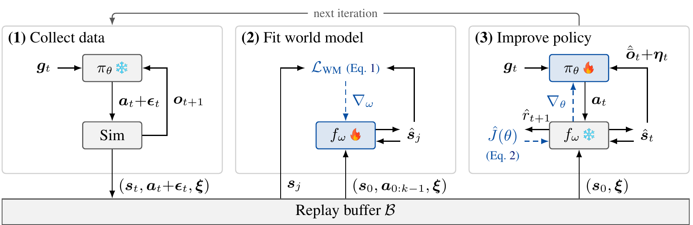
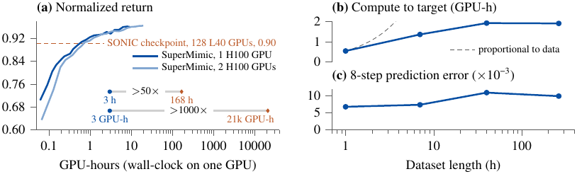
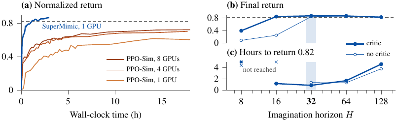
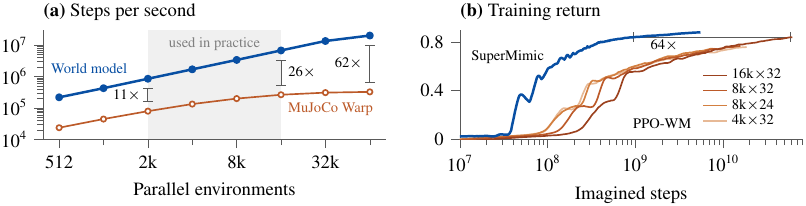
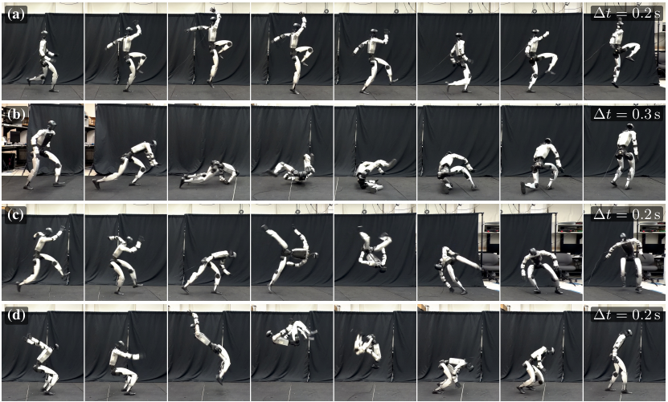

# SuperMimic 学习笔记

北京航空航天大学

goat

26-11-13

SuperMimic是一项发表于CoRL 2026的人形机器人全身控制研究[1]。它学习不同动作共享的身体动力学，再通过可微世界模型优化动作策略，实现大规模运动跟踪。单张H100训练3小时后，SuperMimic动作策略的归一化回报超过SONIC公开的预训练动作策略；SONIC报告的训练配置为128张L40、7天。

本文围绕大规模运动跟踪的训练瓶颈，介绍SuperMimic的主要架构、模型与动作策略的协同训练过程，以及运动跟踪、计算效率和实机部署实验。

## 1 研究背景与问题定义

人形机器人运动跟踪的目标，是根据参考运动和实时观测生成关节控制指令，使机器人在保持稳定的同时复现参考动作。人体动作包含的关节轨迹不能直接作为机器人的可靠控制指令，身体惯量、驱动能力和地面接触都会改变实际运动结果，控制器必须持续修正动作。

现有方法主要依靠无模型强化学习，即不建立供动作策略更新使用的状态转移模型，而直接根据仿真交互数据学习动作策略。部分方案先训练多个动作专家，再蒸馏成统一动作策略；蒸馏是让统一动作策略学习动作专家的输出。另一些方案直接在大规模动作库上训练通用动作策略。随着动作数量和多样性增加，仿真采样与动作策略优化的成本也会提高。

SuperMimic 利用动作之间共享的身体动力学。走路与侧滚具有不同的控制目标，但给定机器人状态、动作和仿真上下文后，状态转移仍由同一具身体的物理规律决定。学习包含接触效应的状态转移规律，有助于在不同动作之间复用训练经验。这里的接触动力学体现在身体与地面相互作用所造成的状态变化，方法并未另设接触力预测模块。

因此，核心问题是如何获得一个可供动作策略优化使用的动力学模型，并在扩大动作覆盖范围的同时控制训练成本。

## 2 总体架构与关键设计

世界模型、目标条件动作策略和价值网络是支撑SuperMimic控制功能的主要模块。目标条件动作策略根据机器人观测和参考目标输出动作；世界模型预测状态转移，并提供观测、奖励和软终止量；价值网络估计从给定状态继续运动的预期折扣回报。折扣回报是对未来各步奖励按时间逐渐降低权重后的累加值。训练还依赖仿真器和经验回放缓冲区；经验回放缓冲区保存过去采集的状态转移，供后续世界模型拟合重复使用。

动作策略使用最近10帧本体观测，并以未来10帧参考动作作为运动跟踪的参考目标。本体观测包括相对于默认姿态的关节位置、关节速度、根部角速度、身体坐标系中的投影重力方向及上一时刻动作。

记机器人状态为 $\boldsymbol s_t$、参考目标为 $\boldsymbol g_t$、动作为 $\boldsymbol a_t$，时间下标t表示当前控制步，θ、ω和ψ分别表示动作策略、世界模型和价值网络的参数。ξ表示仿真上下文（sim context），即域随机化为每个仿真回合采样的摩擦系数、关节标定偏移、躯干质心偏移等参数集合；域随机化通过改变这些参数，让动作策略适应不同的仿真条件。仿真回合指机器人从重置开始到满足终止条件的一段交互，仿真上下文在同一回合内保持固定，与状态一同存入经验回放缓冲区，后续从该状态开始模型推演时仍使用配套的仿真上下文。

传统人形机器人运动跟踪训练通常让动作策略在刚体仿真器中执行动作。刚体仿真器内部依据牛顿力学、碰撞检测和接触求解计算运动；接触切换与碰撞处理使直接穿过整个仿真过程求导较复杂。在论文讨论的无模型强化学习流程中，动作策略更新将仿真器视为黑箱，不利用其内部动力学导数。以近端策略优化（Proximal Policy Optimization，PPO）为例，算法根据大量交互轨迹的奖励估计动作的优势，即该动作相对当前价值估计能带来多少额外回报，再据此估计动作策略参数的梯度。

SuperMimic用神经网络学习可微世界模型，在动作策略优化阶段由它承担状态转移预测。这里的可微（differentiable），指世界模型能够计算预测结果对输入状态和动作的局部导数，这些导数组成雅可比矩阵，用于描述输入微小变化会怎样影响输出。世界模型从仿真器记录的状态转移中学习，无需采集数据的仿真器提供梯度；仿真器继续负责数据采集，世界模型负责动作策略优化所需的轨迹推演。

动作策略在可微世界模型中连续生成动作并预测后果，形成一段想象轨迹，也就是由世界模型计算的控制轨迹。时间反向传播（backpropagation through time，BPTT）沿这段轨迹，利用链式法则把累计回报对后续状态的影响逐步传回早期动作及动作策略参数，得到世界模型预测回报的解析梯度。相较于PPO依靠动作采样估计梯度，这种短时域更新具有更低的梯度方差。结合快速轨迹推演和共享动力学，SuperMimic在与SONIC的整体系统比较中将训练所需GPU小时降低超过1000倍；同一世界模型内的更新方式对照进一步展示了BPTT的效率优势，具体结果见图4(b)。

为了让动作策略在可微世界模型中连续决策，可微世界模型需要同时提供下一状态、奖励、无噪声观测和软终止量，四类输出如公式（1）所示。

$$
\begin{aligned}
\hat{\boldsymbol s}_{t+1}&=f_\omega(\hat{\boldsymbol s}_t,\boldsymbol a_t,\boldsymbol\xi),\\
\hat r_{t+1}&=r_\omega(\hat{\boldsymbol s}_t,\boldsymbol a_t,\boldsymbol g_t),\\
\hat{\bar{\boldsymbol o}}_t&=g_\omega(\hat{\boldsymbol s}_t,\boldsymbol\xi),\\
\hat d_t&=d_\omega(\hat{\boldsymbol s}_t,\boldsymbol g_t).
\end{aligned}
\tag{1}
$$

公式（1）中的帽号表示世界模型中的对应量，上横线表示观测尚未加入传感噪声。动力学头预测下一状态，奖励头根据状态、动作和参考目标计算奖励，观测头将状态转换为动作策略所需的无噪声观测，终止头输出软终止量 $\hat d_t$。软终止量取值在0到1之间，表示轨迹在该状态终止的连续程度，后续用于降低接近终止状态的未来奖励权重。仿真器则根据终止条件产生取值为0或1的硬终止标记 $d_t$，分别表示继续与终止。动力学头由神经网络学习，另外三个头可通过学习或解析计算实现；解析计算指依据已知定义直接求值，无需拟合独立的预测网络。

如图1所示，SuperMimic的训练循环包含三个阶段：动作策略在仿真器中采集状态转移并存入经验回放缓冲区，从经验回放缓冲区抽取短窗口拟合世界模型，再通过固定参数的世界模型推演想象轨迹并更新动作策略。第三阶段同时拟合价值网络，估计想象轨迹末端之后的回报。

**图1 SuperMimic训练循环**

图1采用论文第4页图2。黑色实线箭头表示前向计算与数据传递，蓝色虚线箭头表示梯度反向传播，顶部灰色实线箭头表示进入下一轮训练；雪花图标表示模块参数固定，火焰图标表示模块参数正在更新。图中的Sim指仿真器，Replay buffer指经验回放缓冲区，三个面板依次表示采集数据、拟合世界模型和改进动作策略。图内Eq. 1和Eq. 2保留论文编号，在本文中分别为公式（2）和公式（4）。

## 3 协同训练与参数优化

### 3.1 仿真采样与经验回放

当前动作策略在仿真器中执行动作，采集身体状态、实际执行动作、参考运动位置和仿真上下文。采样阶段给动作加入每维标准差为0.1的高斯噪声，并把加噪后的实际执行动作存入经验回放缓冲区，以便模型准确对应这次状态转移。

新记录替换经验回放缓冲区中最旧的记录。仿真重置时，动作时间轴按1秒划分区间，其中50%的起点均匀采样，40%偏向近期回报低的区间，10%保留过去困难区间的采样权重，从而兼顾覆盖范围与难动作练习。

### 3.2 多步世界模型拟合

世界模型更新从经验回放缓冲区抽取包含8次状态转移的短窗口，以记录状态作为起点，沿记录动作自回归预测后续8步状态。公式（2）给出多步拟合目标，其中k表示窗口内预测的状态转移次数，本研究取k=8，j表示窗口中的第j步。

$$
\mathcal L_{\mathrm{WM}}(\omega)=\mathbb E_{\mathcal B}\sum_{j=1}^{k}\left[\|\hat{\boldsymbol s}_j-\boldsymbol s_j\|^2+(\hat r_j-r_j)^2+\|\hat{\bar{\boldsymbol o}}_j-\bar{\boldsymbol o}_j\|^2+\mathrm{BCE}(\hat d_j,d_j)\right].
\tag{2}
$$

公式（2）比较预测状态 $\hat{\boldsymbol s}_j$、预测奖励 $\hat r_j$、预测无噪声观测 $\hat{\bar{\boldsymbol o}}_j$ 和软终止量 $\hat d_j$ 与各自的监督目标 $\boldsymbol s_j$、$r_j$、$\bar{\boldsymbol o}_j$、$d_j$。二元交叉熵BCE衡量软终止量与硬终止标记的差异。解析计算的头不设置拟合损失；采用解析观测、奖励和终止条件时，世界模型拟合只保留状态预测误差。解析观测、奖励和终止条件在动作策略优化阶段仍用于构造动作策略输入及累计回报。

状态预测误差沿8步预测链反传，以同时约束单步偏差及其累积影响；拟合过程中使用记录动作，保持监督目标与仿真记录一致。

### 3.3 短时域轨迹推演与回报构造

完成本轮世界模型拟合后，固定世界模型参数，从经验回放缓冲区抽取起始状态及其仿真上下文，让当前动作策略在可微世界模型中生成想象轨迹。每个控制步依次进行观测生成、传感噪声采样、动作策略决策、状态预测，以及奖励和软终止量计算，随后更新本体观测历史并继续决策。动作策略是确定性的：给定同样的带噪观测和参考目标，它直接输出一个动作向量，想象轨迹推演时不再从动作概率分布中抽样。

运动跟踪奖励综合评价身体位置、朝向、线速度和角速度误差，以及根部位置与朝向误差，并加入动作平滑与关节限位代价；各跟踪项采用随误差增大而衰减的指数形式，使动作策略跟随参考轨迹，并减少指令突变和关节越界。该奖励省去了自碰撞惩罚。

仿真器根据终止条件产生硬终止标记：根部高度相对参考动作的偏差超过0.25米，或参考动作与机器人根部坐标系中重力方向的竖直分量差超过0.8时，硬终止标记为1。在可微世界模型中，终止头输出取值在 $[0,1]$ 内的软终止量 $\hat d_t$，通过公式（3）更新生存权重，从而调节后续奖励对累计回报的贡献。

$$
\hat c_0=1,\qquad\hat c_{t+1}=\hat c_t(1-\hat d_{t+1}).
\tag{3}
$$

公式（3）中的 $\hat c_t$ 是生存权重，初始值为1，表示从想象轨迹起点持续到当前控制步的权重。它用于把终止条件引入累计回报计算，避免动作策略继续依赖已经终止之后的奖励和末端价值。下一状态的软终止量 $\hat d_{t+1}$ 为0时，生存权重不变；为1时，后续奖励和末端价值的权重归零；取中间值时，后续贡献按比例降低。连续的生存权重还使终止条件能够参与BPTT求导。

一条想象轨迹连续执行32个控制步，即产生32个动作和32次预测状态转移；这条想象轨迹的控制步数称为推演时域H，本研究取H=32。控制频率为50 Hz时，这段预测运动对应0.64秒。将想象轨迹中的奖励累加，并由价值网络补充第32步之后的预期折扣回报，就得到公式（4）的动作策略优化目标。

$$
\hat J(\theta)=\mathbb E\left[
\sum_{t=0}^{H-1}\gamma^t\hat c_t\hat r_{t+1}
+\gamma^H\hat c_HV_\psi(\hat{\boldsymbol s}_H,\boldsymbol g_H,\boldsymbol\xi)
\right],\qquad H=32,\quad\gamma=0.99.
\tag{4}
$$

公式（4）将每步预测奖励 $\hat r_{t+1}$ 按折扣因子 $\gamma$ 和生存权重 $\hat c_t$ 加权累加，再加入末端价值；折扣因子取0.99，使距离当前越远的奖励权重越低。末端价值 $V_\psi$ 是价值网络对第32步之后预期折扣回报的估计，累计目标 $\hat J$ 则是这一预测回报的期望，即对不同采样起点和传感噪声下的想象轨迹取平均。当前控制步的奖励使用 $\hat c_t$ 加权，随后根据下一状态的软终止量更新 $\hat c_{t+1}$。

### 3.4 时间反向传播与动作策略更新

32步推演连接成一张计算图：早期动作影响后续状态，状态变化进一步影响观测、后续动作、奖励和软终止量，并最终影响累计回报与末端价值。计算图记录这些量之间的依赖及运算，BPTT沿计算图反向应用链式法则，计算公式（4）中的累计目标对动作策略参数的梯度。

动作策略更新时固定世界模型和价值网络的参数，同时保留世界模型输出对状态和动作的局部导数，以及价值网络输出对状态的局部导数。向量输出对向量输入的局部导数组成雅可比矩阵；累计目标是标量，它对动作策略参数的偏导数组成梯度。BPTT通过这些局部导数传递累计目标的梯度：未来奖励经后续状态、本体观测、动作策略和动力学头传回早期动作，软终止量通过生存权重影响后续奖励，末端价值则经第32步状态传回此前的状态转移。PPO根据采样动作的优势估计动作策略参数的梯度，BPTT直接利用可微世界模型的局部导数，论文指出其短时域梯度方差更低。

价值网络用同一批想象轨迹计算的广义优势估计回报作为监督目标；广义优势估计将不同预测步数的回报估计加权组合，兼顾近期奖励与价值网络对远期回报的估计。计算从想象轨迹末端向前递推，以末端价值作为起点，监督目标在本轮价值网络拟合时保持固定。一轮训练依次进行仿真采样、沿记录动作展开8步拟合世界模型、固定世界模型并由当前动作策略展开32步，通过BPTT更新动作策略，同时拟合价值网络；改进后的动作策略产生新数据，继续下一轮更新。8步是世界模型的监督窗口，32步是动作策略优化的推演时域，即一条想象轨迹包含的连续控制步数，两者在训练循环中交替使用。

## 4 实验结果与性能分析

### 4.1 运动跟踪性能与训练成本

实验采用归一化回报评价完整仿真回合的运动跟踪质量，即未折扣奖励总和除以最大可能值；它与公式（4）的训练目标不同，后者包含折扣和末端价值。如图2所示，SuperMimic在较少GPU小时内超过SONIC公开预训练动作策略的归一化回报，动作失败数的对比如表1所示；GPU小时是GPU数量与运行小时数的乘积。

**图2 运动跟踪回报与数据规模扩展结果**

**表1 SONIC与SuperMimic的动作覆盖和计算预算**

| 方法与训练点 | 计算配置 | 129514个动作中的失败数 |
| --- | --- | --- |
| SONIC公开预训练动作策略 | 128张L40 训练7天 | 179 |
| SuperMimic | 1张H100 训练3小时 | 25 |
| SuperMimic | 2张H100 训练9.8小时 | 0 |

图2(a)和表1展示了整体系统的训练成本：单张H100训练3小时内，SuperMimic超过SONIC公开预训练动作策略的归一化回报。按作者报告，实际训练耗时降低超过50倍，GPU小时降低超过1000倍。SONIC使用611小时运动数据，SuperMimic使用其中公开的264.56小时数据，双方在同一组129514个动作上评价。

为进一步控制任务设置，实验在LAFAN1的40个动作片段、2.45小时运动数据上比较PPO-Sim；LAFAN1是动作捕捉数据集，PPO-Sim表示直接在仿真器中用PPO训练动作策略。如图3(a)和表2所示，SuperMimic约1.2小时达到0.82的归一化评估回报，PPO-Sim在18小时预算内的最终归一化评估回报分别为0.60、0.70和0.72。

**图3 PPO-Sim对比及推演时域与价值网络消融结果**

**表2 LAFAN1任务上的PPO-Sim对照**

| 方法 | GPU数 | 训练预算与归一化回报 |
| --- | --- | --- |
| SuperMimic | 1 | 约1.2小时达到0.82 |
| PPO-Sim | 1 | 18小时内未达0.82 最终约0.60 |
| PPO-Sim | 4 | 同预算内未达0.82 最终约0.70 |
| PPO-Sim | 8 | 同预算内未达0.82 最终约0.72 |

表2的对照使用相同的参考动作、本体观测、奖励、终止条件、域随机化、网络规模及评估协议。PPO-Sim每张GPU运行8192个仿真环境，SuperMimic运行4096个仿真环境，通过控制任务设置比较动作策略更新方法的训练效率。

### 4.2 模型推演与梯度优化效率

如图4(a)所示，在实际采用的2000至16000个并行环境范围，世界模型每秒计算的控制步数超过MuJoCo Warp的10倍。一个控制步对应50 Hz控制频率下的0.02秒，MuJoCo Warp用四个5 ms物理仿真子步计算这一段运动；世界模型沿用训练时的浮点计算设置。

**图4 世界模型吞吐与动作策略更新效率对比**

图4(b)将PPO也放到相同世界模型中训练，该对照称为PPO-WM。在LAFAN1的行走、跑步和冲刺动作上，SuperMimic达到PPO-WM最佳训练回报所需的想象轨迹控制步数约为后者的1/64。这组结果在共享世界模型的条件下展示了BPTT更新动作策略的效率优势，与图4(a)的世界模型计算速度提升共同解释训练加速的来源。

图2(b)和图2(c)展示了动作数据从1小时扩大到264小时的结果：达到目标归一化回报的计算成本增长较慢，8步归一化状态预测误差保持在0.007至0.011。该误差以预设的状态误差尺度归一化，并在动作策略生成的轨迹上测量，反映共享动力学在扩大动作覆盖范围时仍保持预测精度。

### 4.3 价值估计与部署性能

图3(b)和图3(c)在相同LAFAN1任务上比较推演时域H与价值网络的作用；这里的消融实验通过改变H，并比较使用和不使用价值网络的设置，检验各项设计的作用。图3(b)报告最终归一化训练回报，图3(c)报告达到0.82归一化训练回报的实际训练时间。训练回报来自训练回合，起点随采样分布调整，与图3(a)固定评价全部40个动作得到的归一化评估回报有所区别。

图3(b)中，使用价值网络的16步推演达到0.843的最终归一化训练回报，与不使用价值网络的32步推演所得0.840相当，说明价值网络能够补充较短想象轨迹之后的回报。图3(c)进一步显示，使用价值网络的32步推演最快达到0.82目标归一化训练回报，耗时约0.88小时。将推演时域从64步延长到128步，使用价值网络时的达标时间从1.70小时增加到4.62小时，最终归一化训练回报从0.863变为0.823；两幅子图共同说明，价值网络支持较短推演时域，32步在这组实验中兼顾训练速度与最终归一化训练回报。表3汇总了价值网络、仿真抗推、实机部署及速度参考目标接口实验结果。

**表3 价值估计与部署相关实验结果**

| 实验 | 对照与结果 | 结果解释 |
| --- | --- | --- |
| 推演时域与价值网络 | H=16使用价值网络达到目标归一化训练回报；H=32达标最快 | 末端价值支持较短想象轨迹的动作策略优化 |
| 仿真抗推 | 0.5至4 m/s速度扰动下，使用价值网络的动作策略在0.5至2.4秒内恢复稳定 | 价值网络增强扰动后的恢复能力 |
| 真实G1 | 同一SuperMimic动作策略完成跳步、侧滚、90度及原地360度翻转，无逐动作调参 | 展示SuperMimic动作策略的实机迁移能力 |
| 速度参考目标接口 | 使用速度跟踪奖励训练的动作策略在672个响应中有650个相对稳态误差更低，中位数0.16，蒸馏基线为0.49 | 共享动力学支持不同参考目标接口 |

表3中的仿真抗推实验进一步展示了价值网络对恢复行为的作用：向机器人施加0.5至4 m/s的速度扰动后，使用价值网络训练的SuperMimic动作策略在0.5至2.4秒内恢复稳定。图5展示了同一SuperMimic动作策略部署在真实Unitree G1机器人上的多种运动，无需对每个动作单独调参。

**图5 真实G1上的多种动作执行结果**

图5(a)展示跳步，图5(b)展示侧滚，图5(c)展示90度翻转，图5(d)展示原地360度翻转，覆盖移动、躯干与四肢接触地面的全身运动及翻转动作。速度参考目标接口实验比较了直接使用速度跟踪奖励训练的动作策略与蒸馏基线；蒸馏基线采用运动跟踪奖励，使动作策略从速度指令复现参考运动。直接使用速度跟踪奖励训练的动作策略，在672个速度指令响应中有650个的相对稳态误差更低，误差中位数从0.49降至0.16。相对稳态误差是响应稳定阶段平均速度与指令速度的偏差范数除以指令速度的范数，用于比较不同指令下的相对跟踪精度。运动跟踪和速度参考目标接口使用同一个动力学头。

参考文献

[1] Liao Q, Shao Y, Long J, et al. SuperMimic: Scaling Humanoid Whole-Body Control with One Differentiable World Model[C/OL]//Conference on Robot Learning (CoRL). Austin, TX, 2026[2026-11-14]. https://arxiv.org/abs/2610.28480.

Project website：https://supermimic.github.io/

开源仓库：https://github.com/HybridRobotics/supermimic
