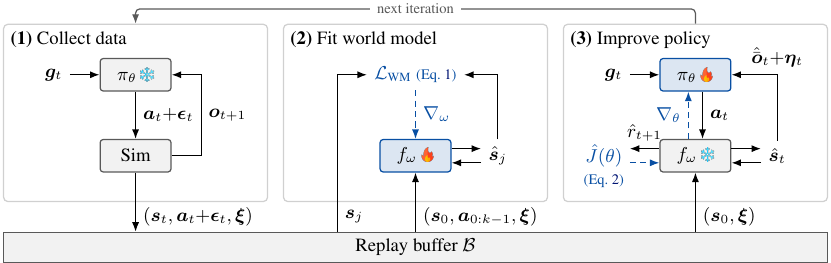
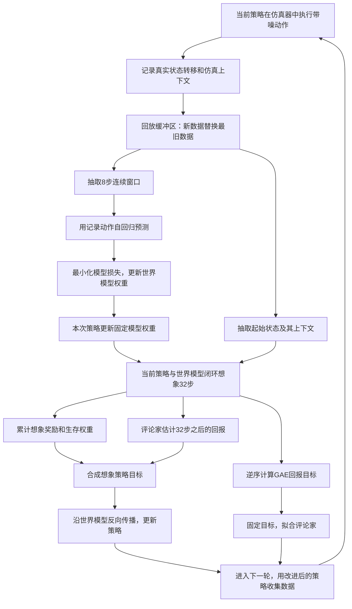

# 02_01 把图 2 与算法 A.1 串成完整训练流程

[返回主文档](../论文精华_三要素.md) · 符号查阅：[02_02](02_02.md) · 公式总目录：[02_10](02_10.md)

## 先看原图，再看数据流和梯度流

来源：p.4，[图 2 与图注 C003](../../reader/paper.md#F002)。下图是对原图的中文梳理。

## 每一步具体在做什么

| 阶段 | 使用什么数据 | 本阶段改变什么 | 需要理解的点 |
| --- | --- | --- | --- |
| 收集 | 当前策略在仿真器中的轨迹 | 回放缓冲区 | 存储实际执行的含噪动作，不能把未加噪动作当成这次转移的输入 |
| 拟合模型 | 缓冲区的连续 8 步窗口 | 世界模型权重 $\omega$ | 从真实记录的初始状态出发，之后喂回自己的预测，动作使用记录动作 |
| 想象 | 缓冲区初始状态＋当前策略 | 生成训练计算图 | 后续状态来自模型，后续动作由当前策略在线产生 |
| 更新策略 | 32 步想象回报＋末端价值 | 策略权重 $\theta$ | 固定模型权重，但保留其对输入的导数 |
| 拟合评论家 | 同一类想象转移算出的 GAE 目标 | 评论家权重 $\psi$ | 目标在本条轨迹的拟合过程中固定，不用边改标签边追标签 |

## “冻结模型”的含义

固定 $\omega$ 只表示**这次策略更新不修改世界模型的参数**。仍然要计算模型输出对状态和动作的导数，才能把回报变化传回策略。

如果把整个世界模型的计算都切断梯度，就无法完成论文所依赖的 BPTT。可把冻结权重理解为“函数形式暂时不变，但仍可问输入改一点，输出会怎样变化”。

评论家的权重也不是策略梯度的更新对象，但末端价值关于末端状态的导数可参与策略更新；这是阅读策略目标的计算依赖所得到的解释。

## 用同一个片段走一遍

**辅助例子：** 缓冲区中有一次站立后前倾的记录。

1. 模型拟合：取这段记录的起点，按记录的动作预测 8 步，与记录结果比较。
2. 策略训练：另取一个记录状态作为起点，让当前策略与模型闭环交互 32 步；策略可以产生不同于旧记录的新动作。
3. 更新：若模型预测某些动作会更接近参考且更不易终止，回报梯度就会推动策略改变输出。
4. 下一轮：改进策略回到仿真器收集数据，世界模型继续拟合，检验和补充其对新访问状态的认识。

## 训练结束后留下什么

部署的是目标编码器与共享解码器构成的策略，输入目标与观测历史，输出关节动作。世界模型主要用于训练中的梯度计算；不能把本方法直接理解为部署时的模型预测控制（MPC）。

原文依据：p.4–6，[S021](../../reader/paper.md#S021)、[S027–S036](../../reader/paper.md#S027)；p.15，[算法 A.1](../../reader/paper.md#A001)。奖励、噪声和终止见 [02_06](02_06.md)、[02_07](02_07.md)。
