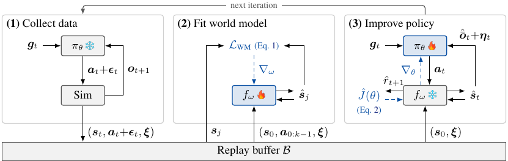
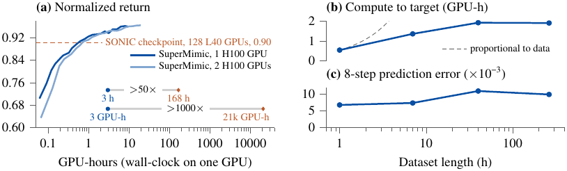

# SuperMimic 论文精华：问题、方法、效果

> 论文：SuperMimic: Scaling Humanoid Whole-Body Control with One Differentiable World Model（arXiv:2610.28480v1）。[完整中英文对照](../reader/paper.md)

**注：** 遇到公式可查 [02_10 全部公式索引](理解笔记/02_10.md)。

## 01 要解决什么问题

**让一个人形机器人控制器学会大量不同动作，同时大幅降低训练所需的算力。**

为了让机器人完成走路、跳跃、舞蹈、侧滚、翻转等全身动作，现有方法通常用无模型强化学习跟踪大量参考动作。动作覆盖得越广，训练成本越高。例如，比较对象 SONIC 使用 128 张 GPU 训练 7 天，约需 21000 GPU 小时。

作者的解释是：**不同动作由同一人形机器人执行，一个世界模型可以复用其中共享的身体动力学与接触效应。** 无模型方法（如PPO）没有显式学习并复用这一结构，而是不断从仿真试验中估计动作后果。本文因此追问：能否先学会“这具身体如何运动”，再让所有动作共用这份知识，减少反复试错的成本？

依据：问题背景见 p.1–2，[S005](../reader/paper.md#S005)、[S006](../reader/paper.md#S006)；“shared body and contact dynamics”的直接表述见 p.7，[§4.2 / S046](../reader/paper.md#S046) 与 [图 3 图注 C004](../reader/paper.md#C004)。这里指学习含接触效应的动力学，不表示论文另外建立了独立接触力模型。

### 理解问题的两个切入点

| 主题 | 阅读重点 |
| --- | --- |
| [01_01 任务概念：运动跟踪与全身控制](理解笔记/01_01.md) | 明确参考动作、策略、训练与部署各自是什么 |
| [01_02 动力学共享与学习成本摊销](理解笔记/01_02.md) | 理解为什么一个模型能服务许多动作 |

## 02 使用了什么方法

**学习一个可微世界模型，再通过它对未来回报求梯度，训练统一的全身控制策略。**

世界模型可以理解为一个从仿真数据中学到的预测器：给定机器人状态、动作和摩擦等仿真参数，预测接下来会发生什么。它与控制策略在同一个循环中交替更新：

1. **收集经验：** 当前策略在标准刚体仿真器中执行动作，将状态转移存入回放缓冲区。
2. **学习身体动力学：** 从缓冲区采样连续 8 步的数据窗口，以[自回归方式](理解笔记/02_11.md)拟合世界模型，让同一个模型服务于整个动作库。
3. **通过想象改进策略：** 暂时固定世界模型，从缓冲区状态出发，预测未来 32 步；对这些想象轨迹进行随时间反向传播（BPTT），计算如何调整策略才能提高回报，再更新策略。

图示依据：p.4，[F002 / C003](../reader/paper.md#F002)；方法依据：p.4–5，[S021](../reader/paper.md#S021)、[S027](../reader/paper.md#S027)、[S030](../reader/paper.md#S030)。

**最值得理解的是“可微”带来的训练方式变化。** PPO 主要根据采样结果，判断哪些动作更值得增加概率；SuperMimic 则沿世界模型直接计算“动作怎样改变，未来回报会怎样改变”。梯度来自学习到的模型，因此不要求原始仿真器本身可微。不过，这仍是模型所定义的替代目标梯度，效果依赖模型质量。

为避免策略只顾眼前 32 步，作者还训练一个**评论家（价值网络）**，估计想象窗口之后的回报。这既支持较短时域，也改善受到扰动后的平衡恢复。

依据：p.5–6，[S025](../reader/paper.md#S025)、[S033](../reader/paper.md#S033)、[S036](../reader/paper.md#S036)；推力恢复实验见 p.8，[S050](../reader/paper.md#S050)。

### 方法与公式详解

| 主题 | 阅读重点 |
| --- | --- |
| [02_01 核心流程图与算法 A.1](理解笔记/02_01.md) | 逐步看数据来源、参数更新和梯度流 |
| [02_02 符号、POMDP、回报与生存权重](理解笔记/02_02.md) | 建立读后续公式所需的符号基础 |
| [02_03 世界模型四头与公式 (1)](理解笔记/02_03.md) | 理解多步自回归拟合和四类损失 |
| [02_04 策略目标公式 (2) 与 BPTT](理解笔记/02_04.md) | 按论文目标完整展开正向计算、逐步反向传播与观测历史路径 |
| [02_05 评论家公式 (3) 与 GAE](理解笔记/02_05.md) | 含递推拆解、λ 的意义和手算例子 |
| [02_06 全部运动跟踪奖励](理解笔记/02_06.md) | 逐项解释表 A.2 的八项公式与权重 |
| [02_07 观测、动作、噪声与终止](理解笔记/02_07.md) | 包括域随机化及所有对应分布和阈值 |
| [02_08 多接口公式 (A.1) 与速度任务](理解笔记/02_08.md) | 解释潜在表示、梯度路由和全部速度奖励 |
| [02_09 重置采样、更新公式与超参数](理解笔记/02_09.md) | 理解困难动作复习和不同训练粒度 |
| [02_10 全部公式索引与数据筛选](理解笔记/02_10.md) | 按公式查笔记，并解释几何可行性判据 |

## 03 达到了什么效果

### 实验怎样验证方法

本文自行测量的实验使用 MuJoCo Warp 和 H100 80 GB GPU；大规模基准为筛选后的 BONES-SEED，共 129514 个动作；受控比较使用 LAFAN1 的 40 个片段。SONIC 的训练成本来自其报告的 L40 集群配置，不能视为同硬件测速。

实验需要分成以下七组理解。每组具体控制哪些变量、采用什么协议、结果能支持多强的结论，见 [03_03 实验设计与逐项解读](理解笔记/03_03.md)。

| 实验 | 要验证什么 | 设置与对照 |
| --- | --- | --- |
| [整体训练成本与动作覆盖](理解笔记/03_03.md#exp1) | 是否能用更少资源达到更好的大规模跟踪结果 | 与 SONIC 检查点在同一动作基准上评分；图 3(a)、表 A.8 |
| [PPO-Sim 受控比较](理解笔记/03_03.md#exp2) | 共享任务和网络设置后是否仍有效率优势 | LAFAN1 上比较仿真 PPO 与本文方法；图 4(a) |
| [数据规模扫描](理解笔记/03_03.md#exp3) | 数据扩展是否显著推高预测误差和训练成本 | 使用 1、7、40、264 小时子集；图 3(b,c) |
| [世界模型与更新机制分析](理解笔记/03_03.md#exp4) | 收益来自轨迹生成更快，还是学习步数更少 | 模型对比 MuJoCo Warp；本文更新对比 PPO-WM；图 5 |
| [评论家与时域消融](理解笔记/03_03.md#exp5) | 评论家对短时域和远期恢复有没有作用 | 有无评论家、不同 H、静态姿态速度扰动；图 4(b,c) 与 §4.3 |
| [真实机器人部署](理解笔记/03_03.md#exp6) | 仿真训练出的一个策略能否实机执行 | Unitree G1 上的跳步、侧滚与翻转；图 6 |
| [下游速度接口](理解笔记/03_03.md#exp7) | 自身任务奖励是否优于参考跟踪信号 | RL 编码器与蒸馏基线，672 个阶跃响应；图 7 |

依据：p.6–9，[实验正文 S038–S054](../reader/paper.md#S038)；p.17–19，[评估协议 S103](../reader/paper.md#S103)、[速度任务 S112–S118](../reader/paper.md#S112)。

### 主要结果

**主要结果是：更少的训练资源，更完整的训练动作覆盖，并能迁移到真实机器人。**

| 观察维度 | 关键结果 | 说明 |
| --- | --- | --- |
| 训练成本 | 单张 H100 训练 3 小时内，回报超过 SONIC 已发布检查点 | 论文报告实际耗时降低超过 50 倍、GPU 小时数降低超过 1000 倍 |
| 动作覆盖 | 在 129514 个动作上，SONIC 失败 179 个；SuperMimic 单 GPU 训练 3 小时失败 25 个，双 GPU 训练 9.8 小时失败 0 个 | 衡量训练动作的覆盖程度 |
| 受控比较 | LAFAN1 上，SuperMimic 单 GPU 约 1.2 小时达到 0.82 评估回报；PPO-Sim 在 18 小时预算内未达到 | 共享动作、奖励、观测、网络规模等设置，但算法和并行环境数仍不同 |
| 数据规模扩展 | 运动数据从 1 小时增至 264 小时，世界模型 8 步预测误差保持在 0.007–0.011 | 达到目标回报所需算力仅缓慢增长 |
| 真实机器人 | 一个通用控制器在 Unitree G1 上执行跳步、侧滚、90° 翻转和原地 360° 翻转 | 无需逐动作调参 |

依据：p.6，[S040](../reader/paper.md#S040)、[S042](../reader/paper.md#S042)；p.7，[S046](../reader/paper.md#S046)；p.8，[S052](../reader/paper.md#S052)；p.17，[S105](../reader/paper.md#S105)。

图示依据：p.7，[F003 / C004](../reader/paper.md#F003)。

**效率提升来自三个环节的叠加：** 一个模型在不同动作间共享动力学知识；世界模型在实际使用的批量下比仿真器快超过 10 倍；解析梯度更新在特定行走、跑步和冲刺实验中，用约少 64 倍的想象步数达到 PPO-WM 的最佳训练回报。这些是不同实验中的机制证据，不能直接相乘成总体加速比。

依据：p.7–8，[S045](../reader/paper.md#S045)至[S048](../reader/paper.md#S048)、[图 5及图注 C006](../reader/paper.md#F005)。

**理解结果时，要保留三个边界：**

- **“超过 1000 倍”不是同硬件、同数据条件下的纯算法加速比。** SONIC 使用 L40 和 611 小时数据；SuperMimic 使用 H100 和 264.56 小时数据。它是两套训练流程的资源比较；受控 PPO-Sim 实验提供了额外支持。[p.6，S041](../reader/paper.md#S041)
- **“零失败”不等于对任意新动作都能成功。** 该基准动作是双方的训练动作，检验的是训练集覆盖，而非未见动作的泛化。[p.17，S105](../reader/paper.md#S105)
- **适用范围仍有限。** 世界模型只从仿真器数据学习，目前训练场景为平地，未覆盖地形和物体交互。[p.9，S059–S060](../reader/paper.md#S059)

### 结果解读与讨论

| 主题 | 阅读重点 |
| --- | --- |
| [03_01 实验指标怎样计算与解读](理解笔记/03_01.md) | 回报、资源、失败数、预测误差及稳态误差 |
| [03_02 核心证据与结论边界](理解笔记/03_02.md) | 区分总体收益、机制证据和未验证的范围 |
| [03_03 实验设计与逐项解读](理解笔记/03_03.md) | 七组实验的目的、设置、对照、指标、结果与限制 |

